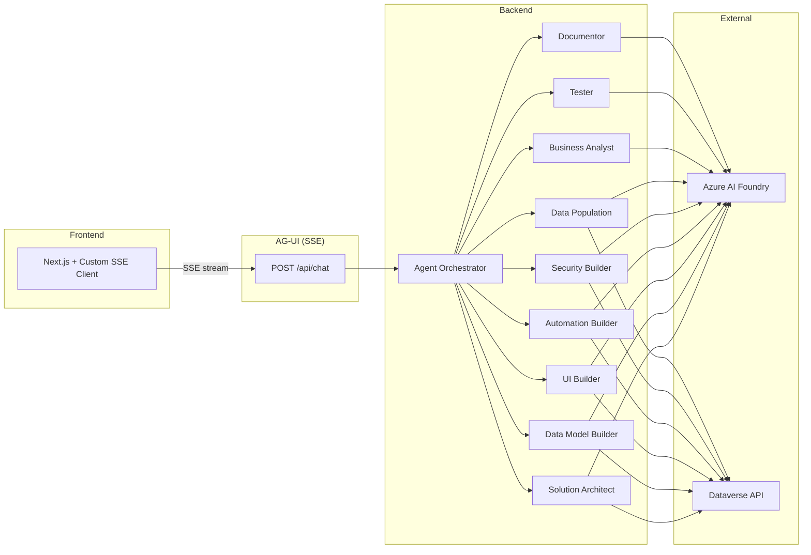

<div align="center">


# Dataverse AI Forge

**Build Microsoft Dataverse solutions just by chatting.**

Describe what you want in plain language — eight specialized AI agents design the data model, build the UI, seed data, wire up security, and verify the result, live against your Dataverse environment.

[](LICENSE)
&nbsp;
&nbsp;
&nbsp;
&nbsp;

[Quick start](#just-here-to-test-it-windows) · [Architecture](#architecture) · [Agent roster](#agent-roster) · [Configuration](#configuration-reference) · [Roadmap](#roadmap--todo) · [Contributing](CONTRIBUTING.md)

</div>

AI-powered platform that builds Microsoft Dataverse solutions through natural language conversation. Eight specialized agents (Solution Architect, Business Analyst, Data Model Builder, UI Builder, Data Population, Tester, Security Builder, Automation Builder) collaborate from a single chat interface — Documentor remains on the roadmap. See the [Agent Roster](#agent-roster) below.

> ### ⚠️ Read this before you run it
>
> **This is an example / reference project — a demonstration of multi-agent orchestration against Dataverse, not a production-ready product.**
>
> - **The agents create _and delete_ Dataverse metadata** — tables, columns, forms, views, security roles, and more. Point it **only at a throwaway developer or trial environment**, never a production org or one holding data you care about.
> - **Localhost-first, no authentication by default.** The backend API is unauthenticated unless you opt in (`Auth:SharedSecret`). **Do not expose it on a network.** See [SECURITY.md](SECURITY.md).
> - Credentials you enter stay **on your machine**, encrypted at rest in `user-settings.json` next to the backend binary — they never leave your computer.
> - Every write is gated behind an in-app **approval** step, and the operation stack supports undo — but treat this as a learning resource, not something to run unattended.

---

## Just here to test it? (Windows)

You don't need to know any of the code. Three steps:

1. **Install the runtimes** (one-time, takes ~5 minutes):
   - [.NET 10 SDK](https://dotnet.microsoft.com/download) — pick the latest x64 SDK installer.
   - [Node.js 22+](https://nodejs.org/) — pick the LTS x64 installer.
   Restart your terminal afterwards so the new commands are on PATH.
2. **Double-click `run.bat`** at the repo root. Two PowerShell windows open — one for the backend, one for the frontend — and your default browser opens to <http://localhost:3000> once the backend is healthy.
3. **Configure credentials in the app**:
   - Click the gear icon (top-right) → **Settings**.
   - Fill in **Azure AI** (Endpoint + API key + default model) and click **Test**. Green = good.
   - Fill in **Dataverse** (Environment URL + Tenant + Client + Secret, OR pick **Interactive** to sign in with your own account and leave Tenant/Client/Secret blank) and click **Test**. Green check = your org name comes back.
   - Hit **Save Settings**. They persist to `backend/src/DataverseForge.Api/bin/Debug/net10.0/data/user-settings.json` so you only enter them once.

Then start a chat — try *"Build me a simple feedback management system on Account"*. To stop, close either of the two PowerShell windows.

If `run.bat` complains about a missing prerequisite, the message tells you which one and where to download it.

---

## Architecture



## Agent Roster

| # | Agent | Role | Status |
|---|-------|------|--------|
| 1 | Solution Architect | Orchestrates workflow, reads environment, manages solutions/publishers, exports + publishes | Active |
| 2 | Business Analyst | Elicits requirements, structures the brief before building | Active |
| 3 | Data Model Builder | Creates tables, fields, relationships, option sets, alternate keys | Active |
| 4 | UI Builder | Forms (incl. CopySystemForm), saved views, charts, dashboards, **model-driven apps** (CRUD + ValidateApp + PublishApp), **sitemaps** (XSD-validated SiteMap XML), **app components** (attach/detach tables/forms/views/charts) | Active |
| 5 | Automation Builder | **Workflow lifecycle management** (Phase 7) — rename / activate / deactivate / delete Business Process Flows + Business Rules. Creation of new workflows is deferred to a future commit (XAML templates require real-environment validation); build new BPFs / Business Rules in the maker portal designer, then manage them here. Plugins / Power Automate flows / classic workflows / custom actions stay out of scope | Active |
| 6 | Security Builder | Security roles + privilege matrices: **create** (with optional RoleTemplate binding) / **update** via privilege delta + optional rename / **delete** with assigned-user safety pre-flight / **bulk grant** one (privilege, depth) onto N roles in a single approval. Field-level security profiles + column security remain out of scope | Active |
| 7 | Data Population | Seeds reference data, generates test records, fetches GUIDs for lookup targets, auto-translates lookup `@odata.bind` | Active |
| 8 | Tester | Verifies post-execution against the planId — schema, option sets, charts, record counts + sample rows | Active |
| 9 | Documentor | Was scoped for data dictionary / changelog / ERD docs | **Not supported** |

The full per-agent breakdown (capabilities, boundaries, handoffs) lives in the **Agents panel** in the UI sidebar — click the Users icon to open it. All agent prompts are in [`backend/src/DataverseForge.Application/Agents/`](backend/src/DataverseForge.Application/Agents/).

Models are **configurable per agent** in Settings → Models. Default deployment ships GPT-4o, but any Azure AI Foundry model (Llama, Mistral, Phi, etc.) works.

## Prerequisites

- [.NET 10 SDK](https://dotnet.microsoft.com/download) (10.0.102+)
- [Node.js 22+](https://nodejs.org/)
- [Azure AI Foundry](https://ai.azure.com) project with model deployments (GPT-4o, Llama, Mistral, etc.)
- [Dataverse environment](https://learn.microsoft.com/power-platform/admin/create-environment) with an [App Registration](https://learn.microsoft.com/power-platform/admin/register-app-azure-active-directory) — see "Dataverse authentication" below for the two supported modes

## Quick Start

### 1. Run the backend

```bash
cd backend
dotnet run --project src/DataverseForge.Api
```

The API starts on `http://localhost:5000`.

### 2. Run the frontend (separate terminal)

```bash
cd frontend
npm install
npm run dev
```

The UI starts on `http://localhost:3000`.

### 3. Configure credentials in the app

Open `http://localhost:3000`, click the **Settings** gear (top-right), fill in:

- **Azure AI** → Endpoint + API key + default model. Click **Test** — green check confirms the model is reachable.
- **Dataverse** → Environment URL + Tenant + Client + Client Secret (or pick **Interactive** auth and leave the secret blank). Click **Test** — green check fetches your org name.

Settings save to `<bin>/data/user-settings.json` (override the directory with `DVFORGE_DATA_DIR`). They survive backend restarts and you only enter them once per machine.

### 4. Start a chat

Click **+ New Project**, type something like *"Build me a simple feedback management system on Account"*. The Solution Architect picks it up, hands off to the Data Model Builder, etc.

> **Tip — power users**: You can pre-load credentials via .NET user-secrets or `appsettings.Development.json` to skip the Settings UI. See "Configuration Reference" below for the keys.

## Configuration Reference

| Variable | Required | Description |
|----------|----------|-------------|
| `AZURE_AI_ENDPOINT` | Yes | Azure AI Foundry resource endpoint |
| `AZURE_AI_API_KEY` | Yes | Azure AI Foundry API key |
| `AZURE_AI_DEFAULT_MODEL` | No | Default model name (default: `gpt-4o`) |
| `DATAVERSE_ENVIRONMENT_URL` | Yes | Dataverse environment URL |
| `DATAVERSE_TENANT_ID` | Yes | Azure AD tenant ID |
| `DATAVERSE_CLIENT_ID` | Yes | App registration client ID |
| `DATAVERSE_CLIENT_SECRET` | If `AuthMode=ServicePrincipal` | App registration client secret |
| `DATAVERSE_AUTH_MODE` | No | `ServicePrincipal` (default) or `Interactive` — see below |
| `DATAVERSE_VERBOSE_LOGGING` | No | `true` to log every Dataverse HTTP request + response body at Information level (default: `false`) — see "Debugging Dataverse calls" |
| `CORS_ALLOWED_ORIGINS` | No | Comma-separated list of allowed origins (default: `http://localhost:3000`) |
| `DVFORGE_DATA_DIR` | No | Override for the writable data directory (solution exports, `user-settings.json`). Defaults to `<bin>/data`. |

## Dataverse authentication

Two modes, configurable in **Settings → Dataverse → Authentication** in the UI (or via `Dataverse:AuthMode` in config):

### Service Principal (default — works headless)
- Requires Tenant ID + Client ID + **Client Secret** on the App Registration.
- App Registration must have an Application User in the Dataverse environment with the necessary security role.
- Suitable for any deployment (server, container, CI). Recommended for shared boxes.

### Interactive — sign in with your own account
- **No App Registration required.** Leave Tenant ID and Client ID blank in Settings → the backend uses [Microsoft's public Power Platform client](https://learn.microsoft.com/en-us/power-apps/developer/data-platform/authenticate-oauth#simple-example) (`51f81489-12ee-4a9e-aaae-a2591f45987d`) which is multi-tenant with `http://localhost` already configured as a redirect URI. You only need a Dataverse user account in the target environment.
- A browser tab opens on the **backend's machine** when the first Dataverse call fires (or when you click Test Connection). You sign in once, the token caches in-process until the backend restarts.
- Only suitable for **localhost development** — won't work for a deployed backend where no human is at the server.
- If you want to use your own App Registration instead (for audit / scoped permissions), provide its Tenant ID + Client ID. The app must be a **public client** with `http://localhost` as a Mobile and desktop application redirect URI.

## Debugging Dataverse calls

Set `Dataverse:VerboseLogging` to `true` (in `user-settings.json` or `appsettings.Development.json`) and restart the backend. Every Dataverse HTTP call is then logged at Information level with full request + response body, e.g.:

```
Dataverse → POST https://contoso.crm.dynamics.com/api/data/v9.2/EntityDefinitions
  Request: {"@odata.type":"...","SchemaName":"adc_Phone",...}
Dataverse ← POST https://contoso.crm.dynamics.com/api/data/v9.2/EntityDefinitions 204 (312 ms)
```

Bodies are truncated at 4000 characters per direction. Auth headers are stripped from the log line. The handler is a no-op when the flag is `false` — zero overhead in production.

You also get a one-line per-turn summary regardless of the flag:

```
Turn completed: session=abc... duration=8412ms agents=[SolutionArchitect → DataModelBuilder → Tester]
```

## Project Structure

```
dataverse-ai-forge/
├── backend/                          # .NET 10 Clean Architecture
│   ├── src/
│   │   ├── DataverseForge.Api/       # ASP.NET host, SSE endpoint, DI
│   │   ├── DataverseForge.Application/ # Agents, tools, orchestration
│   │   ├── DataverseForge.Domain/    # Entities, interfaces (zero deps)
│   │   └── DataverseForge.Infrastructure/ # Dataverse, AG-UI
│   ├── tests/
│   │   ├── DataverseForge.Application.Tests/
│   │   ├── DataverseForge.Domain.Tests/
│   │   └── DataverseForge.Infrastructure.Tests/
│   └── DataverseForge.slnx
├── frontend/                         # Next.js 16 + Custom SSE Client
│   ├── src/
│   │   ├── app/                      # Pages, API route proxy
│   │   ├── components/               # Chat, workspace, approval cards
│   │   ├── hooks/                    # useAgent, useDiagnostics, useProjects
│   │   └── lib/                      # Agents, themes, pricing, types
├── docs/
│   ├── dataverse-ai-forge-spec-v4.md # Full specification
│   └── demo-script.md                # 10-min demo walkthrough
└── README.md
```

## Tech Stack

| Layer | Technology |
|-------|-----------|
| Backend | .NET 10, ASP.NET Core, Clean Architecture |
| Agents | Microsoft Agent Framework, Azure AI Foundry (per-agent model config) |
| Frontend | Next.js 16, React 19, Custom SSE Client (ForgeChatProvider), Tailwind CSS 4 |
| Protocol | AG-UI (SSE) between frontend and backend |
| Persistence | In-memory (LRU-bounded; session state + conversation history live for the lifetime of the process) |
| Observability | Structured logging via `ILogger` (console) + in-process metric counters / histograms via `System.Diagnostics.Metrics` |
| Dataverse | OData v4 REST API, MSAL client credentials |

## Roadmap / TODO

Open work tracked outside of GitHub issues. Roughly ordered by priority.

### Agents
- **Review the Agents panel** content — confirm each agent's role / boundaries / handoff list still match the prompts after recent prompt edits.
- **UI Builder**
  - Check view types coverage — savedquery vs personal vs system; today only main saved views are wired.
  - Model-driven apps + sitemaps + components are now wired (Phases 1–4 below). Roles + scaffold-app orchestrator still pending (Phases 5–6).
- **Data Population** — confirm the end-to-end flow works after the recent fixes (GetRecords tool, lookup auto-rewrite to `@odata.bind`, schema-aware refusal). Validate against pre-existing tables with required lookups.
- **Automation Builder** — ✅ shipped as lifecycle-management-only (Phase 7 / Commits A-D). Rename, activate, deactivate, delete for BPFs + Business Rules. Workflow creation (XAML templating) deferred until validated against a real Dataverse env. Plugins / cloud flows / classic workflows / custom actions remain out of scope.
- **Security Builder** — ✅ shipped. Full CRUD on roles + bulk privilege grant + RoleTemplate binding. Field-level security profiles + column security remain out of scope (UNSUPPORTED.md).

### Model-Driven App Management

Phased rollout — each phase ships end-to-end and is testable independently.

| Phase | Surface | Status |
|---|---|---|
| 1 | Read: list apps, inspect app full (components + sitemap + roles), get sitemap, list roles | **Done** |
| 2 | App CRUD: create / update / delete + `ValidateApp` + scoped `PublishApp` | **Done** |
| 4 | Sitemap CRUD: structured spec → SiteMap XML (XSD-validated against bundled `SiteMap.xsd@9.0.0.2090`) → attach to app | **Done** |
| 3 | Components add / remove / inspect: tables (logical name → MetadataId), forms, views, charts, dashboards | **Done** |
| 5 | Security roles: assign / unassign roles to apps via M:N | **Done** |
| 6 | `scaffold_app` / `teardown_app` orchestrators: one-shot "create / tear down working app for these tables" | **Done** |

The bundled SiteMap XSDs live under [`backend/schemas/9.0.0.2090/`](backend/schemas/9.0.0.2090/). Override the schema directory with the `DVFORGE_SCHEMA_ROOT` env var for ad-hoc testing.

## License

Released under the [MIT License](LICENSE) © 2026 Allan De Castro.

---

<div align="center">

Built as an example of multi-agent orchestration on the Microsoft Power Platform.<br/>
Made with ❤️ for the Power Platform community — [Allan De Castro](https://github.com/allandecastro)

</div>
