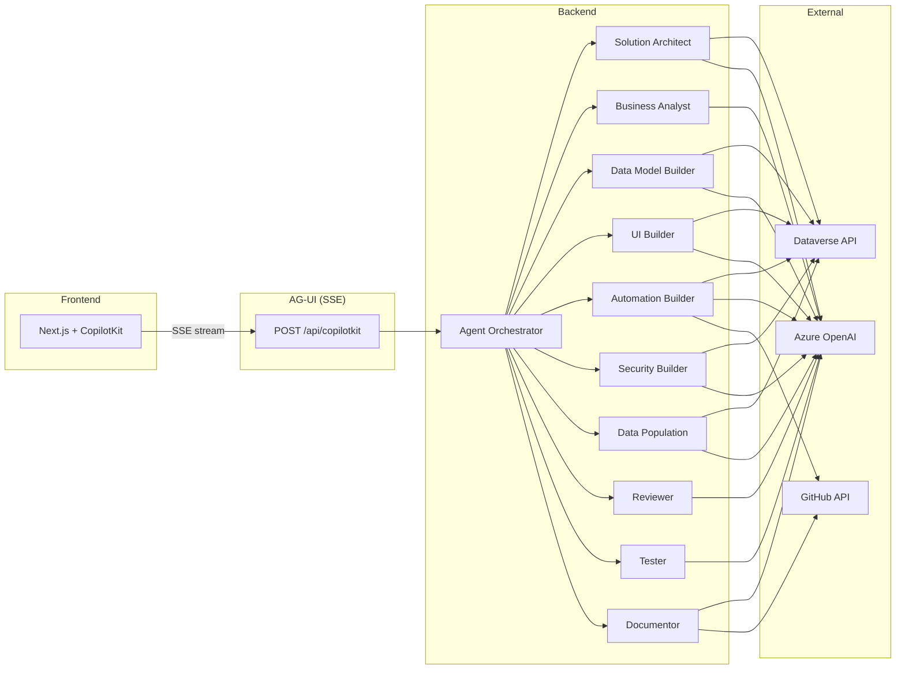

# Dataverse AI Forge

AI-powered platform that builds Microsoft Dataverse solutions through natural language conversation. Ten specialized agents collaborate to design, validate, create, test, document, and secure solutions — all from a single chat interface.



## Agent Roster

| # | Agent | Role | Model |
|---|-------|------|-------|
| 1 | Solution Architect | Orchestrates workflow, reads environment, generates ERDs | GPT-4o |
| 2 | Business Analyst | Elicits requirements, structures SRS | GPT-4o |
| 3 | Data Model Builder | Creates tables, fields, relationships, option sets | GPT-4o |
| 4 | UI Builder | Creates forms, views, dashboards, model-driven apps | GPT-4o-mini |
| 5 | Automation Builder | Generates plugins, BPFs, business rules, custom APIs | GPT-4o |
| 6 | Security Builder | Creates security roles, field security profiles | GPT-4o-mini |
| 7 | Data Population | Seeds reference data and generates test records | GPT-4o-mini |
| 8 | Reviewer | Validates schema design and plugin code pre-execution | GPT-4o-mini |
| 9 | Tester | Verifies created components post-execution | GPT-4o-mini |
| 10 | Documentor | Generates data dictionaries, changelogs, ERD docs | GPT-4o-mini |

## Prerequisites

- [.NET 10 SDK](https://dotnet.microsoft.com/download) (10.0.102+)
- [Node.js 22+](https://nodejs.org/)
- [Azure OpenAI](https://azure.microsoft.com/products/ai-services/openai-service) resource with GPT-4o and GPT-4o-mini deployments
- [Dataverse environment](https://learn.microsoft.com/power-platform/admin/create-environment) with an app registration (client credentials)
- Docker and Docker Compose (for containerized deployment)

## Quick Start: Local Development

### 1. Configure secrets

```bash
cd backend
dotnet user-secrets set "AzureOpenAI:Endpoint" "https://YOUR-RESOURCE.openai.azure.com/"
dotnet user-secrets set "AzureOpenAI:ApiKey" "your-key"
dotnet user-secrets set "Dataverse:EnvironmentUrl" "https://YOUR-ORG.crm.dynamics.com"
dotnet user-secrets set "Dataverse:TenantId" "your-tenant-id"
dotnet user-secrets set "Dataverse:ClientId" "your-client-id"
dotnet user-secrets set "Dataverse:ClientSecret" "your-client-secret"
```

### 2. Run the backend

```bash
cd backend
dotnet run --project src/DataverseForge.Api
```

The API starts on `http://localhost:5000`.

### 3. Run the frontend

```bash
cd frontend
npm install
npm run dev
```

The UI starts on `http://localhost:3000`.

## Quick Start: Docker Compose

```bash
# 1. Create your .env from the template
cp .env.example .env
# Edit .env with your Azure OpenAI and Dataverse credentials

# 2. Build and start
docker compose up --build

# 3. Open the UI
# http://localhost:3000
```

The API runs at `http://localhost:5000` with a healthcheck on `/readyz`. SQLite data persists in a Docker named volume.

## Configuration Reference

| Variable | Required | Description |
|----------|----------|-------------|
| `AZURE_OPENAI_ENDPOINT` | Yes | Azure OpenAI resource endpoint |
| `AZURE_OPENAI_API_KEY` | Yes | Azure OpenAI API key |
| `AZURE_OPENAI_GPT4O_DEPLOYMENT` | No | GPT-4o deployment name (default: `gpt-4o`) |
| `AZURE_OPENAI_GPT4O_MINI_DEPLOYMENT` | No | GPT-4o-mini deployment name (default: `gpt-4o-mini`) |
| `DATAVERSE_ENVIRONMENT_URL` | Yes | Dataverse environment URL |
| `DATAVERSE_TENANT_ID` | Yes | Azure AD tenant ID |
| `DATAVERSE_CLIENT_ID` | Yes | App registration client ID |
| `DATAVERSE_CLIENT_SECRET` | Yes | App registration client secret |
| `GITHUB_TOKEN` | No | GitHub PAT for plugin PR creation and doc push |
| `OTEL_ENDPOINT` | No | OpenTelemetry OTLP collector endpoint (default: `http://localhost:4317`) |

## Project Structure

```
dataverse-ai-forge/
├── backend/                          # .NET 10 Clean Architecture
│   ├── src/
│   │   ├── DataverseForge.Api/       # ASP.NET host, SSE endpoint, DI
│   │   ├── DataverseForge.Application/ # Agents, tools, orchestration
│   │   ├── DataverseForge.Domain/    # Entities, interfaces (zero deps)
│   │   └── DataverseForge.Infrastructure/ # Dataverse, GitHub, SQLite, AG-UI
│   ├── tests/
│   │   ├── DataverseForge.Application.Tests/
│   │   ├── DataverseForge.Domain.Tests/
│   │   └── DataverseForge.Infrastructure.Tests/
│   ├── Dockerfile
│   └── DataverseForge.slnx
├── frontend/                         # Next.js 16 + CopilotKit (headless)
│   ├── src/
│   │   ├── app/                      # Pages, API route proxy
│   │   ├── components/               # Chat, workspace, approval cards
│   │   ├── hooks/                    # useAgent, useDiagnostics, useProjects
│   │   └── lib/                      # Agents, themes, pricing, types
│   └── Dockerfile
├── docs/
│   ├── dataverse-ai-forge-spec-v4.md # Full specification
│   └── phase-checklist.md            # Implementation progress
├── docker-compose.yml
├── .env.example
└── README.md
```

## Tech Stack

| Layer | Technology |
|-------|-----------|
| Backend | .NET 10, ASP.NET Core, Clean Architecture |
| Agents | Microsoft Agent Framework, Azure OpenAI (GPT-4o / GPT-4o-mini) |
| Frontend | Next.js 16, React 19, CopilotKit (headless), Tailwind CSS 4 |
| Protocol | AG-UI (SSE) between frontend and backend |
| Persistence | SQLite (session state, conversation history) |
| Observability | OpenTelemetry (tracing + metrics), structured JSON logging |
| Dataverse | OData v4 REST API, MSAL client credentials |
| GitHub | Octokit (plugin PR creation, documentation push) |
| Containerization | Docker, Docker Compose |

## License

MIT
