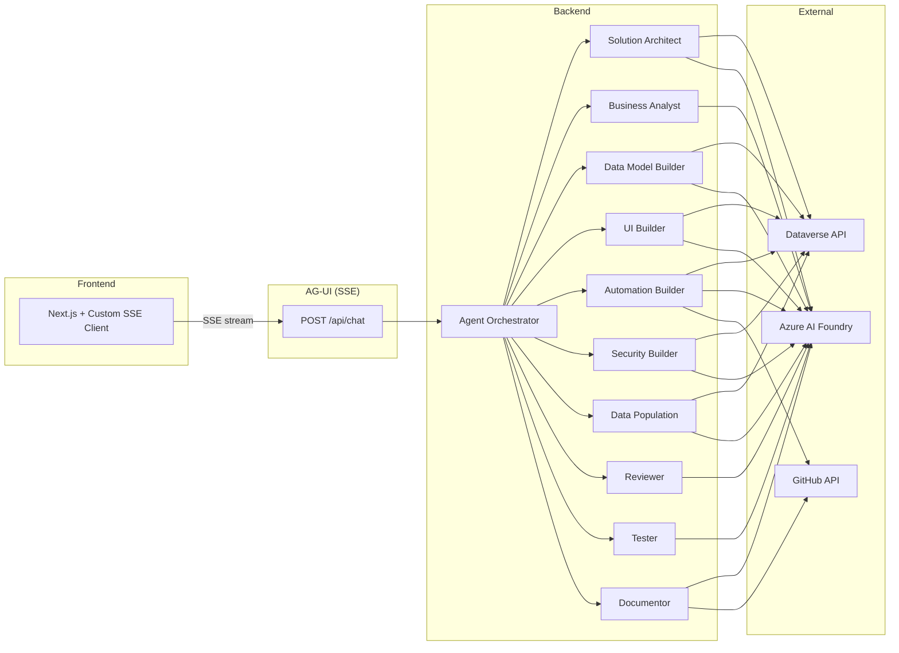

# Dataverse AI Forge

AI-powered platform that builds Microsoft Dataverse solutions through natural language conversation. Ten specialized agents collaborate to design, validate, create, test, document, and secure solutions — all from a single chat interface.



## Agent Roster

| # | Agent | Role | Model |
|---|-------|------|-------|
| 1 | Solution Architect | Orchestrates workflow, reads environment, generates ERDs | Configurable |
| 2 | Business Analyst | Elicits requirements, structures SRS | Configurable |
| 3 | Data Model Builder | Creates tables, fields, relationships, option sets | Configurable |
| 4 | UI Builder | Creates forms, views, dashboards, model-driven apps | Configurable |
| 5 | Automation Builder | Generates plugins, BPFs, business rules, custom APIs | Configurable |
| 6 | Security Builder | Creates security roles, field security profiles | Configurable |
| 7 | Data Population | Seeds reference data and generates test records | Configurable |
| 8 | Reviewer | Validates schema design and plugin code pre-execution | Configurable |
| 9 | Tester | Verifies created components post-execution | Configurable |
| 10 | Documentor | Generates data dictionaries, changelogs, ERD docs | Configurable |

## Prerequisites

- [.NET 10 SDK](https://dotnet.microsoft.com/download) (10.0.102+)
- [Node.js 22+](https://nodejs.org/)
- [Azure AI Foundry](https://ai.azure.com) project with model deployments (GPT-4o, Llama, Mistral, etc.)
- [Dataverse environment](https://learn.microsoft.com/power-platform/admin/create-environment) with an [App Registration](https://learn.microsoft.com/power-platform/admin/register-app-azure-active-directory) — see "Dataverse authentication" below for the two supported modes
- Docker and Docker Compose (for containerized deployment)

## Quick Start: Local Development

### 1. Configure secrets

```bash
cd backend
dotnet user-secrets set "AzureOpenAI:Endpoint" "https://YOUR-RESOURCE.openai.azure.com/"
dotnet user-secrets set "AzureOpenAI:ApiKey" "your-key"
dotnet user-secrets set "Dataverse:EnvironmentUrl" "https://YOUR-ORG.crm.dynamics.com"
dotnet user-secrets set "Dataverse:TenantId" "your-tenant-id"
dotnet user-secrets set "Dataverse:ClientId" "your-client-id"
dotnet user-secrets set "Dataverse:ClientSecret" "your-client-secret"
```

### 2. Run the backend

```bash
cd backend
dotnet run --project src/DataverseForge.Api
```

The API starts on `http://localhost:5000`.

### 3. Run the frontend

```bash
cd frontend
npm install
npm run dev
```

The UI starts on `http://localhost:3000`.

## Quick Start: Docker Compose

```bash
# 1. Create your .env from the template
cp .env.example .env
# Edit .env with your Azure AI Foundry and Dataverse credentials

# 2. Build and start
docker compose up --build

# 3. Open the UI
# http://localhost:3000
```

The API runs at `http://localhost:5000` with a healthcheck on `/readyz`. SQLite data persists in a Docker named volume.

## Configuration Reference

| Variable | Required | Description |
|----------|----------|-------------|
| `AZURE_AI_ENDPOINT` | Yes | Azure AI Foundry resource endpoint |
| `AZURE_AI_API_KEY` | Yes | Azure AI Foundry API key |
| `AZURE_AI_DEFAULT_MODEL` | No | Default model name (default: `gpt-4o`) |
| `DATAVERSE_ENVIRONMENT_URL` | Yes | Dataverse environment URL |
| `DATAVERSE_TENANT_ID` | Yes | Azure AD tenant ID |
| `DATAVERSE_CLIENT_ID` | Yes | App registration client ID |
| `DATAVERSE_CLIENT_SECRET` | If `AuthMode=ServicePrincipal` | App registration client secret |
| `DATAVERSE_AUTH_MODE` | No | `ServicePrincipal` (default) or `Interactive` — see below |
| `DATAVERSE_VERBOSE_LOGGING` | No | `true` to log every Dataverse HTTP request + response body at Information level (default: `false`) — see "Debugging Dataverse calls" |
| `CORS_ALLOWED_ORIGINS` | No | Comma-separated list of allowed origins (default: `http://localhost:3000`) |
| `GITHUB_TOKEN` | No | GitHub PAT for plugin PR creation and doc push |
| `OTEL_ENDPOINT` | No | OpenTelemetry OTLP collector endpoint (default: `http://localhost:4317`) |

## Dataverse authentication

Two modes, configurable in **Settings → Dataverse → Authentication** in the UI (or via `Dataverse:AuthMode` in config):

### Service Principal (default — works headless)
- Requires Tenant ID + Client ID + **Client Secret** on the App Registration.
- App Registration must have an Application User in the Dataverse environment with the necessary security role.
- Suitable for any deployment (server, container, CI). Recommended for shared boxes.

### Interactive — sign in with your own account
- **No App Registration required.** Leave Tenant ID and Client ID blank in Settings → the backend uses [Microsoft's public Power Platform client](https://learn.microsoft.com/en-us/power-apps/developer/data-platform/authenticate-oauth#simple-example) (`51f81489-12ee-4a9e-aaae-a2591f45987d`) which is multi-tenant with `http://localhost` already configured as a redirect URI. You only need a Dataverse user account in the target environment.
- A browser tab opens on the **backend's machine** when the first Dataverse call fires (or when you click Test Connection). You sign in once, the token caches in-process until the backend restarts.
- Only suitable for **localhost development** — won't work for a deployed backend where no human is at the server.
- If you want to use your own App Registration instead (for audit / scoped permissions), provide its Tenant ID + Client ID. The app must be a **public client** with `http://localhost` as a Mobile and desktop application redirect URI.

## Debugging Dataverse calls

Set `Dataverse:VerboseLogging` to `true` (in `user-settings.json` or `appsettings.Development.json`) and restart the backend. Every Dataverse HTTP call is then logged at Information level with full request + response body, e.g.:

```
Dataverse → POST https://contoso.crm.dynamics.com/api/data/v9.2/EntityDefinitions
  Request: {"@odata.type":"...","SchemaName":"adc_Phone",...}
Dataverse ← POST https://contoso.crm.dynamics.com/api/data/v9.2/EntityDefinitions 204 (312 ms)
```

Bodies are truncated at 4000 characters per direction. Auth headers are stripped from the log line. The handler is a no-op when the flag is `false` — zero overhead in production.

You also get a one-line per-turn summary regardless of the flag:

```
Turn completed: session=abc... duration=8412ms agents=[SolutionArchitect → DataModelBuilder → Tester]
```

## Project Structure

```
dataverse-ai-forge/
├── backend/                          # .NET 10 Clean Architecture
│   ├── src/
│   │   ├── DataverseForge.Api/       # ASP.NET host, SSE endpoint, DI
│   │   ├── DataverseForge.Application/ # Agents, tools, orchestration
│   │   ├── DataverseForge.Domain/    # Entities, interfaces (zero deps)
│   │   └── DataverseForge.Infrastructure/ # Dataverse, GitHub, SQLite, AG-UI
│   ├── tests/
│   │   ├── DataverseForge.Application.Tests/
│   │   ├── DataverseForge.Domain.Tests/
│   │   └── DataverseForge.Infrastructure.Tests/
│   ├── Dockerfile
│   └── DataverseForge.slnx
├── frontend/                         # Next.js 16 + Custom SSE Client
│   ├── src/
│   │   ├── app/                      # Pages, API route proxy
│   │   ├── components/               # Chat, workspace, approval cards
│   │   ├── hooks/                    # useAgent, useDiagnostics, useProjects
│   │   └── lib/                      # Agents, themes, pricing, types
│   └── Dockerfile
├── docs/
│   ├── dataverse-ai-forge-spec-v4.md # Full specification
│   └── phase-checklist.md            # Implementation progress
├── docker-compose.yml
├── .env.example
└── README.md
```

## Tech Stack

| Layer | Technology |
|-------|-----------|
| Backend | .NET 10, ASP.NET Core, Clean Architecture |
| Agents | Microsoft Agent Framework, Azure AI Foundry (per-agent model config) |
| Frontend | Next.js 16, React 19, Custom SSE Client (ForgeChatProvider), Tailwind CSS 4 |
| Protocol | AG-UI (SSE) between frontend and backend |
| Persistence | SQLite (session state, conversation history) |
| Observability | OpenTelemetry (tracing + metrics), structured JSON logging |
| Dataverse | OData v4 REST API, MSAL client credentials |
| GitHub | Octokit (plugin PR creation, documentation push) |
| Containerization | Docker, Docker Compose |

## License

MIT
