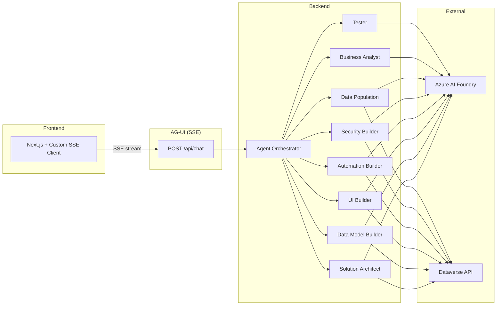

<div align="center">


# Dataverse AI Forge

**Build Microsoft Dataverse solutions just by chatting.**

Describe what you want in plain language: eight specialized AI agents design the data model, build the UI, seed data, wire up security, and verify the result, live against your Dataverse environment.

[](LICENSE)
&nbsp;
&nbsp;
&nbsp;
&nbsp;

[Quick start](#just-here-to-test-it) · [Architecture](#architecture) · [Agent roster](#agent-roster) · [Configuration](#configuration-reference) · [Contributing](CONTRIBUTING.md)

</div>

AI-powered platform that builds Microsoft Dataverse solutions through natural language conversation. Eight specialized agents (Solution Architect, Business Analyst, Data Model Builder, UI Builder, Data Population, Tester, Security Builder, Automation Builder) collaborate from a single chat interface (Documentor remains on the roadmap). See the [Agent Roster](#agent-roster) below.

**Background: this is a proof-of-concept.** Dataverse AI Forge was built in early 2026 as an experiment to explore the **Microsoft Agent Framework**, in particular its **handoff-orchestration** model, driving a _real, side-effecting_ backend (Microsoft Dataverse) rather than a toy demo. It's shared as a learning reference, not an actively maintained product.

> ### ⚠️ Read this before you run it
>
> **This is an example / reference project, a demonstration of multi-agent orchestration against Dataverse, not a production-ready product.**
>
> - **The agents create _and delete_ Dataverse metadata**, tables, columns, forms, views, security roles, and more. Point it **only at a throwaway developer or trial environment**, never a production org or one holding data you care about.
> - **Localhost-first, no authentication by default.** The backend API is unauthenticated unless you opt in (`Auth:SharedSecret`). **Do not expose it on a network.** See [SECURITY.md](SECURITY.md).
> - Credentials you enter stay **on your machine**, encrypted at rest in `user-settings.json` in a per-user data folder. They never leave your computer.
> - Every write is gated behind an in-app **approval** step, and the operation stack supports undo, but treat this as a learning resource, not something to run unattended.

---

## Just here to test it?

### Option A: Desktop app (easiest, nothing to install)

Download the latest installer from the [**Releases**](../../releases) page:

- **Windows** → `Dataverse-AI-Forge-Setup-<version>.exe`
- **macOS** → `Dataverse-AI-Forge-<version>-arm64.dmg`

The app is **self-contained**: the .NET backend and the web UI are bundled, so you don't need .NET or Node installed. It's **unsigned** (no code-signing certificate), so the OS guards the first launch:

- **Windows**: SmartScreen → *More info* → *Run anyway*.
- **macOS**: right-click the app → *Open*.

On first launch, with no credentials configured, you land on an onboarding screen. Open **Settings** and connect Azure AI + Dataverse (see below). On Windows, updates install automatically from GitHub Releases.

> **Locked-down corporate Windows** (AppLocker / WDAC) may block unsigned executables with no user override. If so, use **Option B**, or have IT sign / allowlist the app (an org code-signing cert wired into the build, or Azure Trusted Signing).

### Option B: Run from source (Windows)

1. **Install the runtimes** (one-time): [.NET 10 SDK](https://dotnet.microsoft.com/download) (x64) + [Node.js 22+](https://nodejs.org/) (LTS x64). Restart your terminal.
2. **Double-click `run.bat`** at the repo root. Two PowerShell windows open (backend + frontend) and your browser opens to <http://localhost:3000> once the backend is healthy.
3. **Configure credentials** in the app (gear icon → **Settings**): fill in **Azure AI** and **Dataverse**, click **Test** for each (green = good), then **Save Settings**. They persist to a per-user data folder (see [Data & storage](#data--storage)) so you only enter them once.

Then start a chat. Try *"Build me a simple feedback management system on Account"*.

---

## Architecture



The backend runs on the **[Microsoft Agent Framework](https://github.com/microsoft/agent-framework)** using **handoff orchestration**. A single **Solution Architect** fronts the conversation and hands off to whichever specialist owns the next step, Business Analyst → Data Model Builder → UI Builder → Security Builder → Data Population → Tester, carrying shared session state across each handoff. Each agent is a bundle of typed tools (`[AIFunction]`) over the Dataverse Web API, and every write goes through a `plan_* / execute_*` split gated by an in-app **approval**. The UI and backend talk over the **AG-UI** protocol (Server-Sent Events), streaming assistant tokens, tool calls, and agent-state deltas as they happen.

## Agent Roster

| # | Agent | Role | Status |
|---|-------|------|--------|
| 1 | Solution Architect | Orchestrates workflow, reads environment, manages solutions/publishers, exports + publishes | Active |
| 2 | Business Analyst | Elicits requirements, structures the brief before building | Active |
| 3 | Data Model Builder | Creates tables, fields, relationships, option sets, alternate keys | Active |
| 4 | UI Builder | Forms (incl. CopySystemForm), saved views, charts, dashboards, **model-driven apps** (CRUD + ValidateApp + PublishApp), **sitemaps** (XSD-validated SiteMap XML), **app components** (attach/detach tables/forms/views/charts) | Active |
| 5 | Automation Builder | **Workflow lifecycle management**: rename / activate / deactivate / delete Business Process Flows + Business Rules. Creating new workflows is not supported (build new BPFs / Business Rules in the maker portal designer, then manage them here). Plugins / Power Automate flows / classic workflows / custom actions stay out of scope | Active |
| 6 | Security Builder | Security roles + privilege matrices: **create** (with optional RoleTemplate binding) / **update** via privilege delta + optional rename / **delete** with assigned-user safety pre-flight / **bulk grant** one (privilege, depth) onto N roles in a single approval. Field-level security profiles + column security remain out of scope | Active |
| 7 | Data Population | Seeds reference data, generates test records, fetches GUIDs for lookup targets, auto-translates lookup `@odata.bind` | Active |
| 8 | Tester | Verifies executed work against its planId: schema (tables / fields / option sets / relationships), UI (forms / views / charts / dashboards / sitemaps / apps), security (roles + privilege grants + app-role assignments), automation (BPFs + business rules), and data (record counts + sample rows). Reports PASS / FAIL / PARTIAL | Active |
| 9 | Documentor | Was scoped for data dictionary / changelog / ERD docs | **Not supported** |

The full per-agent breakdown (capabilities, boundaries, handoffs) lives in the **Agents panel** in the UI sidebar, click the Users icon to open it. All agent prompts are in [`backend/src/DataverseForge.Application/Agents/`](backend/src/DataverseForge.Application/Agents/).

Models are **configurable per agent** under **Settings → Azure AI → Per-agent model (optional)**. Leave an agent blank to inherit the global default model. Ships with GPT-4o, but any Azure AI Foundry model (Llama, Mistral, Phi, etc.) works, on the same endpoint + key.

**What's intentionally out of scope** (calculated / formula columns, plugins, custom APIs, field-level / column security, documentation generation, and more): see [UNSUPPORTED.md](UNSUPPORTED.md). When you ask an agent for one of these, it points you to the maker portal instead of half-building it.

## Prerequisites

- [.NET 10 SDK](https://dotnet.microsoft.com/download) (10.0.102+)
- [Node.js 22+](https://nodejs.org/)
- [Azure AI Foundry](https://ai.azure.com) project with model deployments (GPT-4o, Llama, Mistral, etc.)
- [Dataverse environment](https://learn.microsoft.com/power-platform/admin/create-environment) with an [App Registration](https://learn.microsoft.com/power-platform/admin/register-app-azure-active-directory), see "Dataverse authentication" below for the two supported modes

## Quick Start

### 1. Run the backend

```bash
cd backend
dotnet run --project src/DataverseForge.Api
```

The API starts on `http://localhost:5000`.

### 2. Run the frontend (separate terminal)

```bash
cd frontend
npm install
npm run dev
```

The UI starts on `http://localhost:3000`.

### 3. Configure credentials in the app

Open `http://localhost:3000`, click the **Settings** gear (top-right), fill in:

- **Azure AI** → Endpoint + API key + default model. Click **Test**, green check confirms the model is reachable.
- **Dataverse** → Environment URL + Tenant + Client + Client Secret (or pick **Interactive** auth and leave the secret blank). Click **Test**, green check fetches your org name.

Settings save to `user-settings.json` in the per-user data directory (defaults to the OS app-data dir, e.g. `~/Library/Application Support/dataverseforge/data`; change it in-app under **Settings → Data & storage**). They survive backend restarts and you only enter them once per machine.

### 4. Start a chat

Click **+ New Project**, type something like *"Build me a simple feedback management system on Account"*. The Solution Architect picks it up, hands off to the Data Model Builder, etc.

> **Tip for power users**: You can pre-load credentials via .NET user-secrets or `appsettings.Development.json` to skip the Settings UI. See "Configuration Reference" below for the keys.

## Building the desktop installers

The desktop app (Electron) owns both processes: it boots the bundled, self-contained .NET backend and the Next.js server, then opens a native window, so the end user launches nothing by hand. Build unsigned installers locally:

```bash
cd frontend
npm run dist:win    # Windows .exe (NSIS), run on Windows
npm run dist:mac    # macOS .dmg, run on macOS
```

Each publishes the backend self-contained for the matching runtime, runs `next build`, then packages with electron-builder. The Windows installer can't be cross-built from macOS (it needs a native Windows runner).

**CI / Releases**: push a `v*` tag (or run the **desktop-build** workflow from the Actions tab) to build the Windows `.exe` + macOS `.dmg` on native runners and publish them to a GitHub **Release** (created as a draft), alongside the `latest.yml` / `latest-mac.yml` files that drive auto-update. Keep `frontend/package.json` `version` in sync with the tag. Builds are **unsigned** (no Apple/Microsoft developer account required), but the OS flags them on first run (see [Option A](#option-a-desktop-app-easiest-nothing-to-install)).

## Configuration Reference

The primary way to configure the app is the in-app **Settings** UI. For headless / CI setups you can also use `appsettings.json`, .NET user-secrets, or environment variables. As **environment variables**, a double underscore maps to the config `:` separator, so `AzureAI__Endpoint` sets `AzureAI:Endpoint`. `DVFORGE_DATA_DIR` is the one plain (non-sectioned) variable.

| Setting (env var form) | Required | Description |
|----------|----------|-------------|
| `AzureAI__Endpoint` | Yes | Azure AI Foundry resource endpoint |
| `AzureAI__ApiKey` | Yes | Azure AI Foundry API key |
| `AzureAI__DefaultModel` | No | Global default model name (default: `gpt-4o`). Per-agent overrides live under `AzureAI:AgentModels` (Settings → Azure AI → Per-agent model) |
| `Dataverse__EnvironmentUrl` | Yes | Dataverse environment URL |
| `Dataverse__TenantId` | Yes | Azure AD tenant ID |
| `Dataverse__ClientId` | Yes | App registration client ID |
| `Dataverse__ClientSecret` | If `AuthMode=ServicePrincipal` | App registration client secret |
| `Dataverse__AuthMode` | No | `ServicePrincipal` (default) or `Interactive`, see below |
| `Dataverse__VerboseLogging` | No | `true` to log every Dataverse HTTP request + response body at Information level (default: `false`), see "Debugging Dataverse calls" |
| `Cors__AllowedOrigins` | No | Comma-separated list of allowed origins (default: `http://localhost:3000`) |
| `Auth__SharedSecret` | No | When set, requires `Authorization: Bearer <secret>` on every `/api/*` request. Unset (default) = no auth, localhost only. See [SECURITY.md](SECURITY.md) |
| `Security__RequireHttps` | No | `true` to enable HTTPS redirection + HSTS (default: `false`, fine for localhost) |
| `Persistence__Provider` | No | `Sqlite` (default, projects survive a restart) or `InMemory` (ephemeral). See **Data & storage**. |
| `DVFORGE_DATA_DIR` | No | **Operator/Docker override** for the writable data directory (`state.db`, `rag.db`, solution exports, `user-settings.json` + `.secret.key`), e.g. a mounted host volume. When set it pins the location and disables the in-app "Change location" flow. Desktop users leave it unset: the default is the per-user OS app-data dir and the folder is changeable in-app. |

## Data & storage

Everything the app persists stays **on the local machine**, nothing is uploaded. The only outbound traffic is your Azure AI and Dataverse API calls. You can see exactly what's stored, and where, under **Settings → Data & storage** in the app.

**Location**: the writable data directory. It defaults to the per-user OS app-data dir (e.g. `~/Library/Application Support/dataverseforge/data` on macOS, `%APPDATA%\dataverseforge\data` on Windows) and is **changeable in-app** under Settings → Data & storage. Operators can instead pin it with `DVFORGE_DATA_DIR` (e.g. a Docker volume). It contains:

| File | Holds |
|------|-------|
| `state.db` | Your **projects & sessions**, the components they built, and **chat history** (SQLite) |
| `rag.db` | Documents ingested for RAG context (when the RAG feature is used) |
| `user-settings.json` | Connection settings, **secrets encrypted at rest** (AES-256-GCM) |
| `.secret.key` | The local key that encrypts those secrets |

**Persistence provider** (`Persistence:Provider`):
- **`Sqlite`** (default): project state persists to `state.db`, so your projects, the tables/apps/etc. you built, and chat history survive a backend restart. Chat history is stored **server-side** (not the browser), so it follows you across browsers/devices. Deleting a project (with confirmation) removes its stored record.
- **`InMemory`**: nothing is written to disk; everything is lost on restart. Used by the test suite.

**What is *not* persisted**: the persisted record is kept lean: it holds only **business state** (the project and the components it built). The **undo stack** and the **activity/audit log** are session-scoped diagnostics that reset on restart (they still show live in the UI while you work). Components you created **in Dataverse** are never touched by deleting a local project.

## Dataverse authentication

Two modes, configurable in **Settings → Dataverse → Authentication** in the UI (or via `Dataverse:AuthMode` in config):

### Service Principal (default, works headless)
- Requires Tenant ID + Client ID + **Client Secret** on the App Registration.
- App Registration must have an Application User in the Dataverse environment with the necessary security role.
- Suitable for any deployment (server, container, CI). Recommended for shared boxes.

### Interactive: sign in with your own account
- **No App Registration required.** Leave Tenant ID and Client ID blank in Settings → the backend uses [Microsoft's public Power Platform client](https://learn.microsoft.com/en-us/power-apps/developer/data-platform/authenticate-oauth#simple-example) (`51f81489-12ee-4a9e-aaae-a2591f45987d`) which is multi-tenant with `http://localhost` already configured as a redirect URI. You only need a Dataverse user account in the target environment.
- A browser tab opens on the **backend's machine** when the first Dataverse call fires (or when you click Test Connection). You sign in once, the token caches in-process until the backend restarts.
- Only suitable for **localhost development**, won't work for a deployed backend where no human is at the server.
- If you want to use your own App Registration instead (for audit / scoped permissions), provide its Tenant ID + Client ID. The app must be a **public client** with `http://localhost` as a Mobile and desktop application redirect URI.

## Debugging Dataverse calls

Set `Dataverse:VerboseLogging` to `true` (in `user-settings.json` or `appsettings.Development.json`) and restart the backend. Every Dataverse HTTP call is then logged at Information level with full request + response body, e.g.:

```
Dataverse → POST https://contoso.crm.dynamics.com/api/data/v9.2/EntityDefinitions
  Request: {"@odata.type":"...","SchemaName":"adc_Phone",...}
Dataverse ← POST https://contoso.crm.dynamics.com/api/data/v9.2/EntityDefinitions 204 (312 ms)
```

Bodies are truncated at 4000 characters per direction. Auth headers are stripped from the log line. The handler is a no-op when the flag is `false`, zero overhead in production.

You also get a one-line per-turn summary regardless of the flag:

```
Turn completed: session=abc... duration=8412ms agents=[SolutionArchitect → DataModelBuilder → Tester]
```

## Project Structure

```
dataverse-ai-forge/
├── backend/                          # .NET 10 Clean Architecture
│   ├── src/
│   │   ├── DataverseForge.Api/       # ASP.NET host, SSE endpoint, DI
│   │   ├── DataverseForge.Application/ # Agents, tools, orchestration
│   │   ├── DataverseForge.Domain/    # Entities, interfaces (zero deps)
│   │   └── DataverseForge.Infrastructure/ # Dataverse, AG-UI
│   ├── tests/
│   │   ├── DataverseForge.Application.Tests/
│   │   ├── DataverseForge.Domain.Tests/
│   │   └── DataverseForge.Infrastructure.Tests/
│   └── DataverseForge.slnx
├── frontend/                         # Next.js 16 + Custom SSE Client
│   ├── src/
│   │   ├── app/                      # Pages, API route proxy
│   │   ├── components/               # Chat, workspace, approval cards
│   │   ├── hooks/                    # useAgent, useDiagnostics, useProjects
│   │   └── lib/                      # Agents, themes, pricing, types
├── docs/
│   └── demo-script.md                # 10-min demo walkthrough
└── README.md
```

## Tech Stack

| Layer | Technology |
|-------|-----------|
| Backend | .NET 10, ASP.NET Core, Clean Architecture |
| Agents | Microsoft Agent Framework, Azure AI Foundry (per-agent model config) |
| Frontend | Next.js 16, React 19, Custom SSE Client (ForgeChatProvider), Tailwind CSS 4 |
| Protocol | AG-UI (SSE) between frontend and backend |
| Persistence | SQLite by default (`state.db`: projects, built components + chat history survive a restart); in-memory option for ephemeral / test runs |
| Observability | Structured logging via `ILogger` (console) + in-process metric counters / histograms via `System.Diagnostics.Metrics` |
| Dataverse | OData v4 REST API, MSAL client credentials |

## License

Released under the [MIT License](LICENSE) © 2026 Allan De Castro.

---

<div align="center">

Built as an example of multi-agent orchestration on the Microsoft Power Platform.<br/>
Made with ❤️ for the Power Platform community, by [Allan De Castro](https://github.com/allandecastro)

</div>
